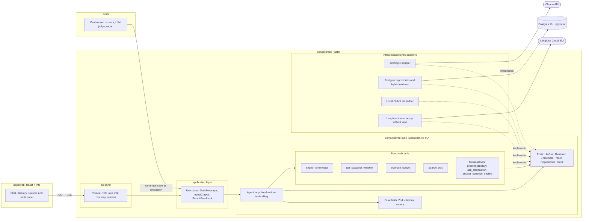

# Wanderly

[](https://github.com/patrickz24/wanderly/actions/workflows/ci.yml)
[](LICENSE)

**An AI travel-planning agent that shows its work.** Describe a trip in plain language; Wanderly asks
when something is unclear, calls read-only tools (travel guide search, seasonal weather, budget,
points of interest) and returns a day-by-day itinerary as validated JSON, with its sources visible.
Under the hood: a hand-written tool-calling loop over Claude, hybrid RAG on Postgres + pgvector,
an LLM evaluation pipeline gated in CI, and Langfuse tracing.

> [!NOTE]
> Wanderly is a **personal demonstration project** built for a portfolio. The brand is fictional.
> It is not a commercial product and is not affiliated with, endorsed by or connected to any
> company. It makes no bookings and shows no real-time prices.

## Status

**🚧 Under construction — milestone 1 of 8.** Most of what this README describes is the target
design; the checklist below says what exists.

- [ ] **1. Foundation** (in progress): monorepo, strict TypeScript, lint/format/commit hooks,
      Fastify with `/health` and `/ready`, validated config, SQL migrations, Dockerfiles, Compose,
      CI with security scans, ADRs 0001 and 0002
- [ ] **2. RAG**: Wikivoyage corpus (already generated for 20 destinations, see
      [`data/`](data/README.md)), ingestion, hybrid retrieval, retrieval evaluation in CI
- [ ] **3. Agent, tools and tracing**: agent loop, tools, persistence, SSE, Langfuse traces
- [ ] **4. Guardrails and structured outputs**: validation and repair, citation checks, input
      guard, rate limiting, daily cost cap
- [ ] **5. Evaluation pipeline**: `npm run eval`, deterministic scorers, calibrated LLM judge, CI
      gate
- [ ] **6. Web client**: chat, step-by-step progress, itinerary view, sources and tools panel,
      feedback
- [ ] **7. Deployment and online metrics**: public demo, rollback, dashboards
- [ ] **8. Final documentation**: real results, observability case study, demo GIF

| Item      | Where                                               |
| --------- | --------------------------------------------------- |
| Live demo | _Placeholder: public URL published at milestone 7._ |
| Demo GIF  | _Placeholder: recorded at milestone 8._             |
| CI        | Badge above (`.github/workflows/ci.yml`).           |

## How it works

1. **Agent loop.** A short tool-calling loop, written by hand without an agent framework. The
   model always ends a turn by calling a **terminal tool** (`present_itinerary`,
   `ask_clarification`, `answer_question` or `decline`), so every answer is typed and validated
   with Zod, with one repair attempt if validation fails.
2. **Read-only tools.** `search_knowledge` (hybrid search over the corpus),
   `get_seasonal_weather` (monthly climate normals), `estimate_budget` (a pure function: the agent
   copies its figure, or says the cost is unknown, and never invents a price) and `search_pois`
   (points of interest filtered by type, crowd level and month).
3. **Hybrid RAG.** Postgres 16 + pgvector: vector search and full-text search fused with
   Reciprocal Rank Fusion. Embeddings are computed locally, so retrieval is free, deterministic and
   testable in CI without secrets.
4. **Grounding over fluency.** Citations must point to sources returned by tools in the same run.
   Destinations outside the corpus are declined rather than answered from the model's memory.
5. **Evaluation.** Retrieval metrics, an agent test set scored by deterministic checks, and an LLM
   judge calibrated against human annotations, gated in CI.
6. **Observability.** The domain emits events through a `Tracer` port; a Langfuse adapter turns
   them into traces with cost per conversation. Without Langfuse keys, tracing is a no-op.

## Architecture



**Layer rule:** `domain` imports nothing but itself and Zod; `application` orchestrates the domain
through ports; `infrastructure` implements the ports; `api` only talks to `application`. ESLint
enforces the domain and application boundaries, and `services/api/src/main.ts` is the single
composition root. See [ADR 0002](docs/adr/0002-layered-architecture-and-ports.md).

**Evaluations call the real use case** (`SendMessage`) with the same prompt, tools and model as
production: an evaluation that reimplements the call measures something other than what ships.

## Quick start

Requires Docker with the Compose plugin (`docker compose`).

```bash
cp .env.example .env    # then set SESSION_SECRET (required) and ANTHROPIC_API_KEY
docker compose up --build
# open http://localhost:8080
```

`SESSION_SECRET` needs at least 32 characters; `.env.example` shows how to generate one.
`ANTHROPIC_API_KEY` is only used from milestone 3, when the agent arrives. With `make`, `make up`
does the same in one step and creates `.env` with a random session secret if it is missing.

Compose starts Postgres with pgvector, applies the migrations, then runs the API and the web client
(nginx on port 8080, proxying `/api`, `/health` and `/ready` to the API). Host ports are bound to
`127.0.0.1` only. At milestone 1 that means the health endpoints and the web shell; the chat
arrives with milestones 3 and 6.

### Local development

Requires Node.js 22 or newer.

```bash
npm ci
set -a; . ./.env; set +a  # export the variables from .env into this shell (Bash)
docker compose up -d db   # Postgres only
npm run migrate
npm run dev:api           # http://localhost:3000
npm run dev:web           # http://localhost:5173, proxies /api to the API
```

`make dev` runs the same sequence. `make help` lists every target. Scripts, testing policy and
commit conventions are in [CONTRIBUTING.md](CONTRIBUTING.md).

## Evaluation results

**No results yet.** They will be generated by `npm run eval` (milestone 5) and published in
`docs/EVALUATIONS.md` and `evals/baselines/latest.json`. This README will only show numbers that
come from a real run.

What will be measured:

- **Retrieval** (milestone 2, deterministic, no API key): Recall@5 and MRR@10 on about 40 labelled
  queries, comparing vector-only, full-text-only and hybrid search, and chunking variants.
- **Agent** (milestone 5): at least 36 versioned cases (clear requests, ambiguous requests, out of
  scope, direct and indirect prompt injection, destinations outside the corpus, multi-turn
  follow-ups), scored property by property: response type, schema validity, citation integrity,
  numbers grounded in tool outputs, constraint fit, guardrails, tool errors, cost and latency.
- **LLM-as-judge** (milestone 5): faithfulness and fit to the request, judged by a different model
  than the agent, calibrated against human annotations with the agreement rate and Cohen's kappa
  published.

The agent's sampling temperature cannot be set on the target models, so results vary between runs.
CI therefore uses hard gates only on near-deterministic invariants and margins on quality metrics,
with thresholds set **after** the first measurement.

## Tech choices and trade-offs

| Area                 | Choice                                                                                           | Why                                                                               | What we give up                                                     |
| -------------------- | ------------------------------------------------------------------------------------------------ | --------------------------------------------------------------------------------- | ------------------------------------------------------------------- |
| Monorepo             | npm workspaces                                                                                   | No extra tooling; `npm run eval` just works                                       | No build cache or task graph; weaker isolation than pnpm            |
| HTTP                 | Fastify 5 + `fastify-type-provider-zod`                                                          | Route validation and types from Zod; official helmet, CORS and rate-limit plugins | Less familiar than Express                                          |
| Database access      | `pg`, raw SQL, SQL migrations                                                                    | Retrieval is pgvector and `tsvector` SQL; an ORM would hide it                    | No generated types; more mapping code                               |
| Agent runtime        | Hand-written loop, no framework                                                                  | Every line explainable; testable with a fake LLM; domain not coupled to an SDK    | We own limits, retries and parallel tool execution                  |
| Models               | Agent `claude-haiku-5-5`, judge `claude-sonnet-5-5`, set by env variables                        | Low cost per request; judge differs from the agent                                | A smaller agent model; a comparison with Sonnet as agent is planned |
| Embeddings           | Local `bge-small-en-v1.5` (ONNX, CPU) behind an `Embedder` port                                  | Free, no second API key, deterministic, runs in CI without secrets                | Heavier image and more RAM; quality vs hosted models to be measured |
| Retrieval            | Vector + full-text, fused with Reciprocal Rank Fusion                                            | Uses ranks only, so no fragile score normalisation                                | No cross-encoder re-ranking yet                                     |
| Languages            | English corpus; the agent rewrites queries in English and answers in the user's language         | A small English model and Postgres `english` full-text are enough                 | Depends on the model's query rewriting                              |
| Output               | Terminal tools, strict tool schemas, Zod and business validation                                 | Typed output; "schema-valid" is checked separately from "correct"                 | An extra round trip when a repair is needed                         |
| Streaming            | Server-sent step events (tool started, tool finished, response)                                  | The final output is validated JSON; partial JSON adds complexity for nothing      | No token-by-token streaming                                         |
| Observability        | Langfuse Cloud (EU) behind a `Tracer` port                                                       | Self-hosted Langfuse needs ClickHouse, Redis, object storage and a worker         | A third-party data processor                                        |
| Web client           | React + Vite + Tailwind, hand-written SSE hook                                                   | Standard; the state is a single conversation                                      | No SSR; stream parsing maintained by hand                           |
| Hosting              | Fly.io + Neon recommended, decided at milestone 7                                                | Docker images, healthchecks, rollback; managed Postgres with pgvector             | Vendor dependency; a VPS would be cheaper but needs more operations |
| Quality and security | Vitest, ESLint, Prettier, husky + lint-staged + commitlint; npm audit, Trivy, CodeQL, Dependabot | Rules and scans are enforced by tools in CI                                       | Slower commits and CI                                               |

Claude API behaviours that shaped the design, as documented when the plan was written:

- Sampling temperature cannot be set on the target models, so evaluations must handle variance.
- Forced `tool_choice` is not accepted on every target model, so the agent uses `auto` with strict
  tools and re-prompts once if the model answers in free text.
- Thinking blocks must be sent back unchanged in later turns, so history is append-only and the LLM
  port carries provider blocks as opaque values.
- A `refusal` stop reason becomes a `decline` response.
- Parallel tool calls run concurrently and all results go back in a single message.
- The SDK retries timed-out requests, so the agent enforces its own global deadline with an
  `AbortSignal`.

## Out of scope

- Real-time prices, availability and bookings.
- User accounts. Sessions are anonymous cookies.
- Destinations outside the curated corpus: the agent declines them on purpose.
- Self-hosted Langfuse: it needs ClickHouse, Redis, object storage and a worker, too heavy for a
  one-command demo.

## Roadmap

Candidates after milestone 8, not commitments:

- Cross-conversation memory of preferences.
- Semantic chunking, cross-encoder re-ranking and native BM25 (`pg_search`).
- Dedicated prompt-injection classifier, if evaluations show the current layers are not enough.
- Online LLM judge on sampled production traffic.
- Compaction of long conversations.
- Redis-backed rate limiting for several instances.
- Model routing (fall back from Haiku to Sonnet on failure) and a second LLM provider adapter.
- End-to-end tests with Playwright.

## Documentation

- [Documentation index](docs/README.md)
- [Architecture Decision Records](docs/adr/README.md):
  [0001 monorepo and stack](docs/adr/0001-monorepo-and-stack.md),
  [0002 layered architecture and ports](docs/adr/0002-layered-architecture-and-ports.md)
- [Security policy](SECURITY.md), including data handling and retention
- [Contributing guide](CONTRIBUTING.md)
- [Corpus format, regeneration and licensing](data/README.md)

**Privacy:** conversation content is sent to Anthropic to generate responses and, when configured,
to Langfuse for tracing. Conversations will be deleted after 30 days (the purge job is planned
before the public demo opens). Do not enter personal information.

## License

Code: [MIT](LICENSE), © 2026 patrickz24.

Data, licensed separately from the code:

- The travel corpus in `data/corpus/` is adapted from English Wikivoyage articles and is licensed
  **CC BY-SA 4.0**. Per-article provenance and the list of changes are in
  [`data/corpus/ATTRIBUTION.md`](data/corpus/ATTRIBUTION.md).
- Climate normals are computed from [Open-Meteo](https://open-meteo.com/) data, licensed
  **CC BY 4.0** ("Weather data by Open-Meteo.com"). Open-Meteo's free API is for non-commercial
  use, which fits this demo.

Details are in [`data/README.md`](data/README.md#licensing).
