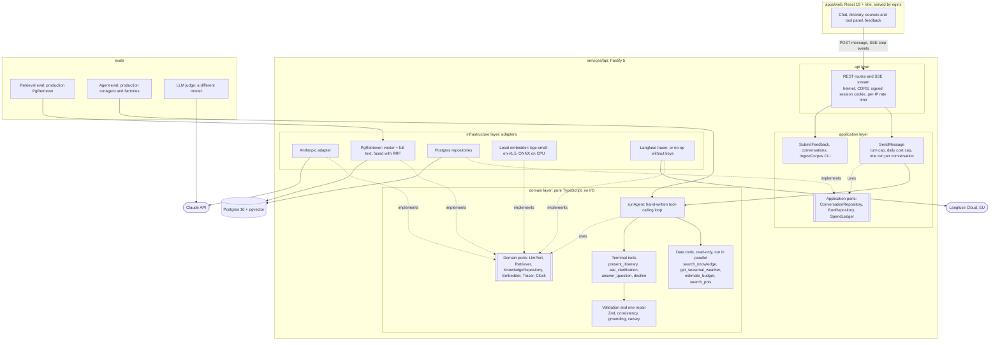
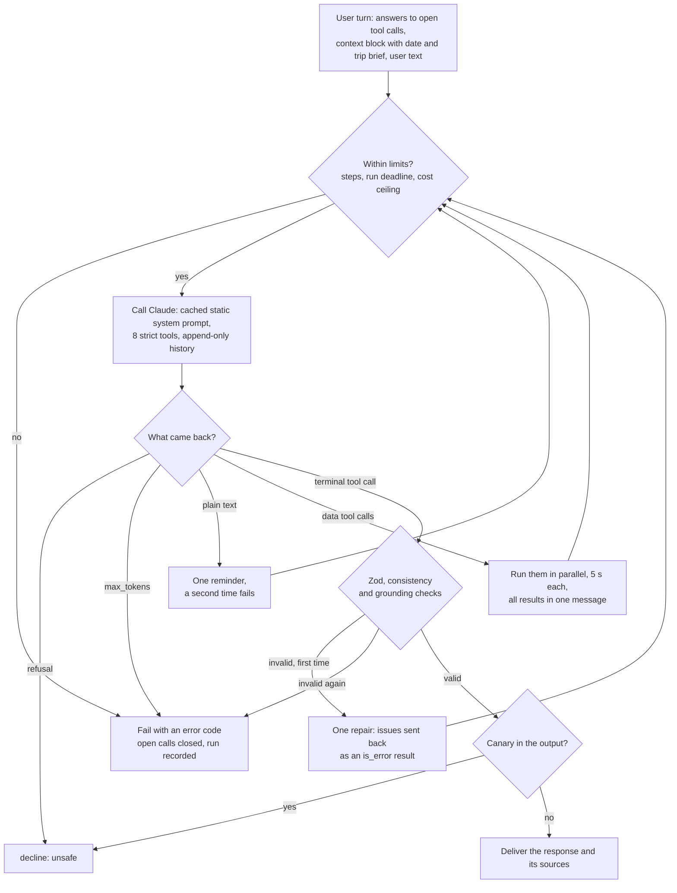

# Wanderly

[](https://github.com/patrickz24/wanderly/actions/workflows/ci.yml)
[](LICENSE)

**A travel-planning agent that shows its work.** Describe a trip in plain language: Wanderly asks
when something is unclear, calls read-only tools and returns a validated day-by-day itinerary that
cites a source for every claim. Under the hood: a hand-written tool-calling loop over Claude,
hybrid RAG on Postgres + pgvector, CI-gated evaluations and Langfuse tracing.

> [!NOTE]
> Wanderly is a **personal demonstration project** built for a portfolio. The brand is fictional.
> It is not a commercial product and is not affiliated with, endorsed by or connected to any
> company. It makes no bookings and shows no real-time prices.

## Contents

- [Status](#status)
- [Architecture](#architecture)
- [Quick start](#quick-start)
- [How a request flows](#how-a-request-flows)
- [Evaluation](#evaluation)
- [Tests](#tests)
- [Key technical choices](#key-technical-choices)
- [Limitations](#limitations)
- [Out of scope](#out-of-scope)
- [Roadmap](#roadmap)
- [Documentation](#documentation)
- [License](#license)

## Status

Code for milestones 1 to 6 is complete; deployment (7) is prepared but not done. **No paid run has
happened yet**: the project has no Anthropic API key, no Langfuse keys and no hosting accounts so
far. Everything below that needs one of them is marked _pending_.

| Area                     | Today                                                                                                                                                                                                                         |
| ------------------------ | ----------------------------------------------------------------------------------------------------------------------------------------------------------------------------------------------------------------------------- |
| Agent runtime            | Implemented and unit-tested with a scripted fake model: loop, parallel tools, terminal tools, validation and one repair, limits, cost ceiling. **Not yet run against the real Claude API** (pending a key).                   |
| Retrieval (RAG)          | Implemented and **measured** on the real corpus (20 destinations, 89 documents, 2,136 chunks): see [Evaluation](#evaluation).                                                                                                 |
| API and persistence      | Conversation API with SSE, anonymous sessions, rate limits, daily cost cap; covered by unit tests and by integration tests over a real Postgres.                                                                              |
| Web client               | Chat, step-by-step progress, itinerary view, sources and tool panel, feedback, error states. A demo mode with sample data (`?demo=1`) shows the UI without calling any model.                                                 |
| Agent evaluation         | Dataset, scorers, judge, gates and CI workflow implemented; the three keyless control runs pass. **Real baseline pending** (needs `ANTHROPIC_API_KEY`), so the soft gates and the Haiku vs Sonnet comparison are pending too. |
| Judge calibration        | **Pending**: needs a human to label outputs from the first real run.                                                                                                                                                          |
| Observability            | Langfuse adapter implemented and tested against an in-memory exporter; no-op without keys. **No real trace yet** (no Langfuse keys). See [OBSERVABILITY.md](docs/OBSERVABILITY.md).                                           |
| Deployment and live demo | **Pending deployment**: Fly.io + Neon configuration, `make deploy` and a manual deploy workflow are ready ([DEPLOYMENT.md](docs/DEPLOYMENT.md)); the accounts do not exist yet.                                               |
| Data retention           | **Pending**: the 30-day purge job is not written yet; it must exist before the public demo opens.                                                                                                                             |
| Human review of datasets | **Pending**: the retrieval labels and the agent cases were proposed by the build agent and are marked as such.                                                                                                                |

**Live demo:** pending deployment. **Demo GIF:** pending (recorded once the demo is live).

## Architecture



The agent loop inside `runAgent` ([`run-agent.ts`](services/api/src/domain/agent/run-agent.ts)):



**Layer rule.** `domain` imports nothing but itself and Zod; `application` orchestrates the domain
through ports; `infrastructure` implements the ports; `api` calls use cases only. ESLint
(`no-restricted-imports`) fails the build when a file crosses a boundary, and
`services/api/src/main.ts` is the single composition root
([ADR 0002](docs/adr/0002-layered-architecture-and-ports.md)).

**The evaluation runs the production agent.** The agent evaluation calls `runAgent` with the
production prompt, tools, guardrails, model adapter factory and limits (shared factories in
`services/api/src/composition/agent-deps.ts`) over the production Postgres retriever. It does not
go through HTTP or persistence, so the daily cap and the session rules are covered by unit and
integration tests instead.

## Quick start

Requires Docker with the Compose plugin. From the repository root:

```bash
cp .env.example .env                 # set SESSION_SECRET (32+ chars) and, for the agent, ANTHROPIC_API_KEY
docker compose up --build -d --wait  # db, migrations, corpus seeding, API, web
# open http://localhost:8080
```

- The first `up` runs the one-shot `seed` service, which embeds the whole corpus on CPU (several
  minutes) before the API starts; later runs skip unchanged documents. The API image ships the
  embedding model and the corpus, so nothing is downloaded at runtime.
- `make up` does the same and creates `.env` with a random `SESSION_SECRET` when it is missing.
  `make seed` re-runs the ingestion (idempotent).
- Without `ANTHROPIC_API_KEY`, everything starts and the conversation API works, but each agent run
  ends with "The AI service is temporarily unavailable". To see the UI without a key, open
  `http://localhost:8080/?demo=1` (sample data built from the corpus, no model called).
- **Windows:** `onnxruntime-node` crashes natively on the development host when it creates the
  inference session ([ADR 0004](docs/adr/0004-local-embeddings.md)). Use the containers for
  anything that embeds text: the Compose stack above (`make up`, `make seed`),
  `make eval-agent-docker` and `make eval-retrieval-docker`. Unit tests and the keyless evaluation
  controls run natively.

Host-side development (Node.js 22+, Linux or macOS for the API): `npm ci`, then `make dev` starts
Postgres, migrates and runs the API (`:3000`) and the Vite dev server (`:5173`). Scripts, make
targets and the testing policy are in [CONTRIBUTING.md](CONTRIBUTING.md).

## How a request flows

1. **Browser.** The client posts `{ text }` to `POST /api/conversations/:id/messages` and reads the
   answer as Server-Sent Events. nginx serves the client and proxies `/api` on the same origin,
   with buffering off for the stream.
2. **HTTP layer.** helmet and a CORS allow-list, a signed `httpOnly` session cookie, a per-IP rate
   limit (10 messages per 10 minutes by default) and Zod validation (at most 2,000 characters).
3. **Use case (`SendMessage`).** Before any model call: the conversation must belong to the
   session, have no run in progress and fewer than 12 turns, and today's spend plus the per-run
   ceiling must fit the daily cap. Otherwise a JSON error is returned and nothing is spent.
4. **Agent loop (`runAgent`).** A static, cached system prompt (rules, destination catalog,
   canary); a user turn with the date and the structured trip brief; then model calls, parallel
   read-only tools and a terminal tool whose output is validated, repaired once if needed. Each
   tool start and end is streamed as an SSE event.
5. **Persistence.** In one transaction: the new messages are appended (the table rejects updates),
   the trip brief is updated, and the run is recorded in `agent_runs` with tokens, cost, latency
   and quality flags. Failed and cancelled runs are recorded too, so the daily cap sees their cost.
6. **Tracing.** One Langfuse trace per run (session = conversation), a generation per model call
   with our computed cost, a span per tool call, and online scores. A no-op without keys.
7. **Answer.** The client receives `response` then `run.finished` (steps, tokens, cost, latency,
   trace id), renders the itinerary with its sources and tool calls, and sends thumbs up or down to
   `POST /api/runs/:id/feedback`.

## Evaluation

Methodology and full results: [docs/EVALUATIONS.md](docs/EVALUATIONS.md). Every figure below comes
from a committed run or a command run for this README; nothing is estimated.

### Retrieval: measured

Run of 2026-10-10 (`evals/baselines/retrieval.json`): 53 queries over the 20 destinations, the real
corpus, the production retriever and embedding model. Metrics in %, 95 % bootstrap intervals in
parentheses. Selected rows:

| Chunking                     | Strategy                        |         Recall@5 |           MRR@10 | Hit@1 | p50 latency |
| ---------------------------- | ------------------------------- | ---------------: | ---------------: | ----: | ----------: |
| structure-aware              | vector                          | 79.2 (68.9–89.6) | 75.0 (64.1–84.9) |  67.9 |       13 ms |
| structure-aware              | full text, all words            | 23.6 (12.3–35.8) | 26.4 (15.1–37.7) |  26.4 |       10 ms |
| structure-aware              | full text, any word             | 59.7 (47.5–72.0) | 51.6 (40.9–63.2) |  39.6 |       12 ms |
| structure-aware              | **hybrid, all words (default)** | 80.2 (69.8–89.6) | 75.0 (64.4–84.5) |  66.0 |       16 ms |
| structure-aware              | hybrid, any word                | 81.1 (70.8–90.6) | 69.7 (59.5–79.7) |  58.5 |       18 ms |
| fixed 300 tokens, 40 overlap | vector                          | 68.9 (57.5–80.2) | 63.3 (52.3–74.5) |  54.7 |       15 ms |

What the numbers support, as paired differences on the same queries (95 % CI):

- **Structure-aware chunking beats fixed-size windows** with vector search: +10.4 points of
  Recall@5 (2.8 to 18.9) and +11.7 of MRR@10 (1.1 to 21.7).
- **Hybrid beats full text alone**: hybrid (any word) minus full text (any word) is +21.4 points
  of Recall@5 (10.4 to 33.0).
- **Hybrid is not proven better than vector alone.** Hybrid (any word) minus vector: +1.9 points
  of Recall@5 (−3.8 to 7.5) and −5.3 of MRR@10 (−13.0 to 1.9); both intervals contain 0. The
  default, hybrid with all words, has the same MRR@10 as vector (75.0) and a lower Hit@1. It is
  kept because its lexical list is the mechanism for exact names that a small embedding model
  handles poorly, a benefit this dataset does not demonstrate; if a human-reviewed dataset still
  shows no gain, vector-only is the simpler choice ([ADR 0005](docs/adr/0005-hybrid-retrieval-with-rrf.md)).

Caveats: labels proposed by the build agent and not yet reviewed by a human; 53 queries, so
intervals are wide; latency measured on a shared development machine. The retrieval evaluation
needs no secret: CI runs it on every pull request that touches the API, the contracts, the corpus
or the evaluations (forks included) and posts the table in the job summary, as a report rather
than a gate. Locally: `make eval-retrieval-docker` (any OS) or `make eval-retrieval` (Linux, macOS).

### Agent: designed, baseline pending

- **Dataset:** 45 versioned cases, 27 in English and 18 in French, in seven categories: clear
  requests (14), ambiguous (8), out of scope (5), direct injection (6), indirect injection through
  a planted document (3), real destinations outside the corpus (5) and multi-turn follow-ups (4).
  Expectations come from the corpus, never from a model.
- **Deterministic scorers,** one per property: response type, schema validity first try and after
  repair, citation integrity and grounded numbers recomputed from the raw trajectory, constraint
  fit, interest coverage, clarification in both directions, guardrails, canary leaks, tool errors,
  cost, latency.
- **LLM judge** (`claude-sonnet-5-5`, a different model from the agent's `claude-haiku-5-5`) for
  claim-level faithfulness and request fit, with documented rubrics and known biases
  ([ADR 0013](docs/adr/0013-llm-as-judge-and-calibration.md)).
- **Gates** ([ADR 0012](docs/adr/0012-evaluation-strategy-and-ci-gates.md)): hard gates on
  near-deterministic invariants (schema valid after repair = 100 %, zero canary leaks, citation
  integrity ≥ 95 %, ≥ 90 % of attempts scored); soft gates on quality metrics, set from the first
  baseline minus its noise margin. With 45 cases the noise floor of a pass rate is about ±15
  points.
- **Baseline: pending the first real run.** The soft gates are `null` in `evals/thresholds.json`
  and reported as pending, never as passed.

**Keyless controls, passing.** Three policies run through the real loop, tools and guardrails on
in-memory ports, in CI and locally (`npm run eval:controls`). Re-run on 2026-10-11 at commit
`c403cad`, 45 cases, 1 rep:

| Control        | Must        | Result                                                                                                            |
| -------------- | ----------- | ----------------------------------------------------------------------------------------------------------------- |
| `oracle`       | score 100 % | 100 % on every applicable metric: PASS                                                                            |
| `null-decline` | score low   | `response_type_correct` 22.2 % (CI 11.1–35.6), `clarified_when_needed` 0 %, while `guardrail_pass` is 100 %: PASS |
| `null-empty`   | score low   | `response_type_correct` 0 %, `schema_valid_after_repair` 0 %: PASS                                                |

The `null-decline` row is why safety metrics are never read alone: an agent that declines
everything is perfectly "safe".

## Tests

Counts from runs on 2026-10-11 at commit `1e05ba0` (the next commit, `c403cad`, only changed a
document):

| Suite                                              | Command                    | Result                       |
| -------------------------------------------------- | -------------------------- | ---------------------------- |
| Unit and component tests, all workspaces           | `npm test`                 | **1,115 passed** in 88 files |
| of which `services/api`                            |                            | 547 passed (42 files)        |
| of which `apps/web`                                |                            | 291 passed (20 files)        |
| of which `data` scripts                            |                            | 130 passed (11 files)        |
| of which `evals`                                   |                            | 104 passed (10 files)        |
| of which `packages/contracts`                      |                            | 43 passed (5 files)          |
| API integration tests, real Postgres 16 + pgvector | `npm run test:integration` | **49 passed** in 5 files     |

Unit tests never call a model or the network: the agent is tested with a scripted fake LLM, and
time is injected through a `Clock` port. Integration tests run against a disposable pgvector
database.

## Key technical choices

| Area              | Choice                                                                                                                            | Why                                                                                             | What we give up                                                        |
| ----------------- | --------------------------------------------------------------------------------------------------------------------------------- | ----------------------------------------------------------------------------------------------- | ---------------------------------------------------------------------- |
| Monorepo          | npm workspaces, strict TypeScript, Zod at every boundary ([0001](docs/adr/0001-monorepo-and-stack.md))                            | One language and one schema library from the API to the web client and the evals                | No build cache or task graph; weaker isolation than pnpm               |
| Architecture      | Layers with ports and adapters ([0002](docs/adr/0002-layered-architecture-and-ports.md))                                          | The loop is testable with fakes; the eval runs production code; adapters are swappable          | More files and indirection for a small service                         |
| Chunking          | One chunk per Markdown section with a breadcrumb header ([0003](docs/adr/0003-corpus-and-structure-aware-chunking.md))            | Measured +10.4 Recall@5 over fixed windows; labels survive re-chunking                          | Depends on well-structured Markdown; sizes not swept yet               |
| Embeddings        | Local `bge-small-en-v1.5` on ONNX CPU ([0004](docs/adr/0004-local-embeddings.md))                                                 | Free, deterministic, no second secret; the retrieval eval needs no key                          | RAM and CPU-bound ingestion; English only; crashes natively on Windows |
| Retrieval         | Vector + full text fused with RRF in Postgres ([0005](docs/adr/0005-hybrid-retrieval-with-rrf.md))                                | Ranks only, no score normalisation; one database                                                | Not proven better than vector alone on this dataset                    |
| Agent runtime     | Hand-written loop, no framework ([0006](docs/adr/0006-hand-written-agent-runtime.md))                                             | Every line explainable; failure paths unit-tested; no SDK in the domain                         | We follow API changes ourselves; no token streaming                    |
| Provider port     | Opaque provider blocks, append-only history ([0007](docs/adr/0007-llm-provider-abstraction-and-opaque-blocks.md))                 | Thinking blocks round-trip verbatim; cacheable prefix; a second provider is one adapter         | Provider concepts still leak into the port                             |
| Observability     | Langfuse behind a `Tracer` port, no-op without keys ([0008](docs/adr/0008-observability-with-langfuse.md))                        | Per-run trace tree, cost per conversation, online scores                                        | Conversation content goes to a third party                             |
| Structured output | Four strict terminal tools, Zod, grounding checks, one repair ([0009](docs/adr/0009-structured-output-through-terminal-tools.md)) | Shape guaranteed by the provider, content by our checks; portable across Haiku, Sonnet and Opus | A repair costs one more model call                                     |
| Guardrails        | Read-only tools first, then prompt, output and canary checks ([0010](docs/adr/0010-layered-guardrails.md))                        | An injection can produce bad text, never an action                                              | Heuristic injection signals are easy to evade; no classifier           |
| Cost control      | Daily cap in the database, per-run ceiling, turn cap, per-IP limits ([0011](docs/adr/0011-cost-control-and-rate-limiting.md))     | Spending is bounded before it happens and holds across restarts                                 | Rate limits are in memory: one instance only                           |
| Evaluation        | Atomic scorers, oracle and null controls, hard and soft gates ([0012](docs/adr/0012-evaluation-strategy-and-ci-gates.md))         | Regressions in grounding or safety fail the PR; thresholds come from measurement                | Small n: only large regressions are visible                            |
| Judge             | Claim-level faithfulness and request fit, different model ([0013](docs/adr/0013-llm-as-judge-and-calibration.md))                 | Catches unsupported prose that citation checks cannot see                                       | Same model family as the agent; uncalibrated until human labels exist  |

Claude API behaviours that shaped the design (checked when the plan was written, 2026-10-09):
sampling temperature cannot be set on the target models, so evaluations handle variance; forced
`tool_choice` is rejected on Sonnet and Opus 5.5, so the agent uses `auto` with strict tools and
one reminder; thinking blocks must be replayed unchanged, so history is append-only; the SDK
retries timeouts, so the run enforces its own deadline with an `AbortSignal`.

## Limitations

- **The agent has not met the real model yet.** Its behaviour, cost per request and latency are
  unmeasured; so are prompt-cache hits, thinking replay over several turns and the strict tool
  schemas on the real API.
- **Small, agent-written datasets.** 53 retrieval queries and 45 agent cases, proposed by the build
  agent and pending human review. Only large differences are visible.
- **The judge is uncalibrated** and belongs to the same model family as the agent.
- **Injection heuristics are signals, not a barrier**, and the canary only detects verbatim leaks.
  Signals are logged; they are not yet attached to traces as scores.
- **Single instance.** The rate limiter and the one-run-per-conversation guard live in memory.
- **The daily cap protects spending, not availability**: anyone can use up the demo's budget for
  the day, and concurrent runs can overshoot the cap by at most one per-run ceiling each.
- **Frozen prompt prefix.** Changing the destination catalog, the canary or a tool description
  invalidates the stored reasoning of ongoing conversations.
- **Corpus coverage is uneven** and cost figures are sparse ([data/README.md](data/README.md#known-limitations)).
- **No retention purge yet** (see [Status](#status)).

## Out of scope

- Real-time prices, availability and bookings.
- User accounts: sessions are anonymous cookies.
- Destinations outside the curated corpus: the agent declines them on purpose.
- Self-hosted Langfuse: it needs ClickHouse, Redis, object storage and a worker, too heavy for a
  one-command demo.
- Several API instances (would need a shared rate-limit store).

## Roadmap

Next, in order (the first three need an account or a human):

1. First real agent evaluation with `--reps 3`, then the soft gates from its proposed thresholds,
   and the Haiku vs Sonnet comparison.
2. Human review of both datasets and judge calibration (agreement and Cohen's kappa).
3. Deployment to Fly.io + Neon with the retention purge, then online dashboards and the first
   trace-based diagnosis in [OBSERVABILITY.md](docs/OBSERVABILITY.md).
4. Observability gaps: injection and canary signals as trace scores, retrieval ranks and the
   prompt version in the traces ([known gaps](docs/OBSERVABILITY.md#5-known-gaps)).

Candidates after that, not commitments: cross-conversation memory of preferences, a cross-encoder
re-ranker, native BM25 (`pg_search`), an injection classifier if the evaluation shows the current
layers are not enough, an online judge on sampled traffic, compaction of long conversations,
Redis-backed rate limiting, model routing and a second provider adapter, Playwright end-to-end
tests.

## Documentation

- [Documentation index](docs/README.md): evaluations, observability, deployment, interview notes.
- [Architecture Decision Records](docs/adr/README.md), 0001 to 0013.
- [Security policy](SECURITY.md), including data handling and retention.
- [Contributing guide](CONTRIBUTING.md): setup, scripts, make targets, evaluations, ADR process.
- [Corpus format, regeneration and licensing](data/README.md).

**Privacy:** conversation content is sent to Anthropic to generate responses and, when configured,
to Langfuse Cloud (EU) for tracing. The UI asks users not to enter personal information.

## License

Code: [MIT](LICENSE), © 2026 patrickz24.

Data, licensed separately from the code:

- The travel corpus in `data/corpus/` is adapted from English Wikivoyage articles and is licensed
  **CC BY-SA 4.0**. Per-article provenance and the list of changes are in
  [`data/corpus/ATTRIBUTION.md`](data/corpus/ATTRIBUTION.md).
- Climate normals are computed from [Open-Meteo](https://open-meteo.com/) data, licensed
  **CC BY 4.0** ("Weather data by Open-Meteo.com"). Open-Meteo's free API is for non-commercial
  use, which fits this demo.

Details are in [`data/README.md`](data/README.md#licensing).
