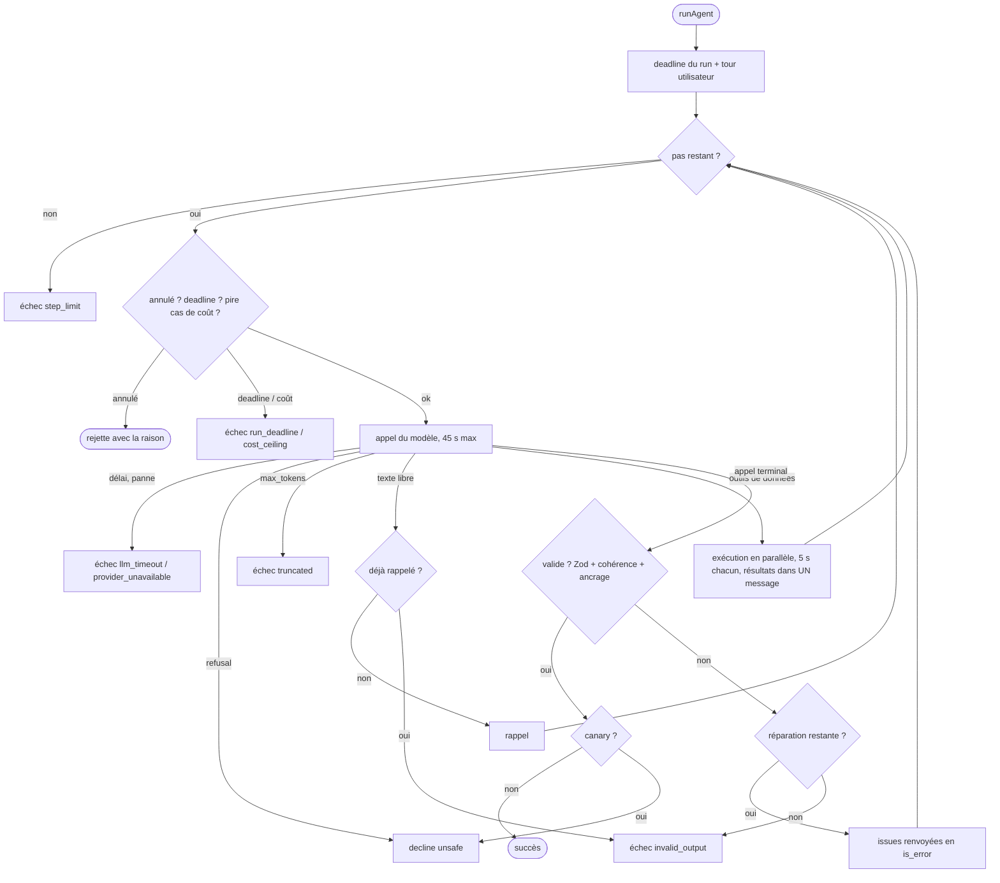

# Guide d'apprentissage : la boucle agent

Ce guide t'accompagne pour comprendre en profondeur la boucle de _tool calling_ de Wanderly, puis
la réécrire toi-même sur la branche `learning/agent-loop`. Il fait partie du
[kit d'apprentissage](../LEARNING.md).

- **Partie 1, les concepts** : le problème, les alternatives, les décisions (avec les ADR).
- **Partie 2, la lecture guidée** du vrai code, ligne par ligne, et pourquoi chaque test existe.
- **Partie 3, l'exercice** : dix étapes dans l'ordre des tests, avec des indices progressifs.
- **Partie 4, les questions d'entretien** sur ce sujet, avec des réponses modèles.
- **Partie 5, la grille d'auto-relecture** pour comparer ta version à l'originale.

Ordre conseillé : partie 1, puis l'exercice (partie 3) avec les indices seulement quand tu bloques,
puis la partie 2 pour comparer, puis la grille (partie 5) et les questions (partie 4). La partie 2
décrit l'implémentation d'origine : la lire avant l'exercice revient à recopier.

> Les références `fichier:ligne` pointent vers `main` au commit `912b95d`. Si `main` a bougé
> depuis, une ligne peut s'être décalée de quelques rangs : cherche le nom de la fonction.

## Partie 1 : les concepts

### 1.1 Le problème

Un LLM ne fait rien : il produit du texte, ou une **demande** d'appel d'outil (`tool_use`, un nom
et des arguments JSON). C'est le programme qui exécute l'outil, renvoie le résultat
(`tool_result`) et rappelle le modèle, jusqu'à ce que le modèle ait fini. Cette boucle est le
cœur de tout « agent ». Elle tient en dix lignes dans un tutoriel ; en production, tout le travail
est dans ce qui l'entoure :

- **Que veut dire « fini » ?** Le modèle peut s'arrêter en texte libre, être coupé
  (`max_tokens`), refuser (`refusal`), ou ne jamais s'arrêter.
- **Que faire quand un outil échoue ?** Une base qui ne répond pas ne doit pas tuer la
  conversation : le modèle peut souvent continuer sans.
- **Comment rendre la sortie fiable ?** L'interface affiche un itinéraire typé, pas de la prose.
  Et « valide selon le schéma » ne veut pas dire « vrai » : il faut vérifier que chaque citation,
  chaque prix et chaque météo vient d'un outil.
- **Comment borner le temps et l'argent ?** Un modèle peut boucler, un appel peut pendre, et le
  SDK retente les timeouts.
- **Comment tester tout ça** sans payer un appel de modèle, et de façon déterministe ?

### 1.2 Ce que la boucle de Wanderly garantit

1. **Une sortie typée et validée.** Le tour se termine toujours par l'appel d'un **outil
   terminal** (`present_itinerary`, `ask_clarification`, `answer_question`, `decline`) dont les
   arguments _sont_ la réponse. Elle passe Zod (la forme), puis des règles métier et d'ancrage (le
   fond). Une sortie invalide a droit à **une** réparation. Le texte libre a droit à **un**
   rappel. ([ADR 0009](../adr/0009-structured-output-through-terminal-tools.md))
2. **L'ancrage.** Un **registre de preuves** par run retient tout ce que les outils ont renvoyé ;
   une citation n'est acceptée que si elle y figure. Ce qui vient de la mémoire du modèle, ou d'un
   tour précédent, est refusé.
3. **Les échecs d'outils sont des données.** Outil inconnu, arguments invalides, destination
   inconnue, panne, délai dépassé : tout devient un `tool_result` avec `is_error: true`, et le
   modèle s'adapte.
4. **Des limites dures.** Nombre d'appels au modèle, délai par appel, délai par outil, délai du
   run, plafond de coût vérifié **avant** chaque appel sur son pire cas.
5. **Un historique append-only.** Rien n'est jamais modifié ; les blocs de raisonnement signés du
   fournisseur sont rejoués à l'identique.
   ([ADR 0007](../adr/0007-llm-provider-abstraction-and-opaque-blocks.md))
6. **Des erreurs attendues rendues comme des valeurs** (`status: 'error'` avec une raison fine et
   ce qui a été dépensé), des bugs qui remontent comme des exceptions, et une annulation qui
   rejette avec sa raison.
7. **Testable en millisecondes** avec un faux LLM scripté. ([ADR 0006](../adr/0006-hand-written-agent-runtime.md))

### 1.3 Les alternatives, et pourquoi celle-ci

| Option                                       | Ce qu'elle apporte                          | Pourquoi elle n'a pas été retenue                                                                                                                                                                                                                       |
| -------------------------------------------- | ------------------------------------------- | ------------------------------------------------------------------------------------------------------------------------------------------------------------------------------------------------------------------------------------------------------- |
| LangChain / LangGraph, Vercel AI SDK         | Boucle prête, graphes d'états, intégrations | Un modèle de messages à eux, à travers lequel les blocs opaques (`thinking` signé) doivent survivre ; nos règles (outils terminaux, registre de preuves, réparation, plafond) finiraient en hooks ; plus de surface à expliquer que la boucle elle-même |
| _Tool runner_ du SDK Anthropic               | Moins de code, hooks par tour               | Bêta, cache la boucle, couple le domaine au SDK ([ADR 0006](../adr/0006-hand-written-agent-runtime.md))                                                                                                                                                 |
| Claude Managed Agents                        | Boucle et bac à sable hébergés              | On n'a besoin ni de l'un ni de l'autre, et l'ancrage doit être vérifié chez nous, avant l'utilisateur                                                                                                                                                   |
| `tool_choice` forcé sur un outil « respond » | Le modèle est obligé d'appeler l'outil      | Refusé (400) sur Sonnet et Opus 5.5 ; sur Haiku 5.5, un appel forcé saute le raisonnement. D'où `auto` + consigne + **un** rappel                                                                                                                       |
| `output_config.format` (JSON outputs)        | JSON garanti sur le message final           | Ne contraint que le message final, se combine mal avec une boucle d'outils ([ADR 0009](../adr/0009-structured-output-through-terminal-tools.md))                                                                                                        |
| Un seul outil `respond` avec une union       | Un outil au lieu de quatre                  | Un paramètre union de plus dans le budget du mode strict, et un choix moins clair pour le modèle que quatre outils nommés                                                                                                                               |
| Texte libre parsé après coup                 | Simple                                      | Aucune garantie de forme, parsing fragile, rien contre quoi réparer                                                                                                                                                                                     |
| Réessayer jusqu'à ce que ce soit valide      | Moins d'échecs visibles                     | Coût du pire cas non borné ; une seule réparation garde le pire cas prévisible                                                                                                                                                                          |

Le prix de ce choix, à dire en entretien : on suit soi-même l'évolution de l'API (nouveaux
`stop_reason`, nouveaux types de blocs), il n'y a pas de streaming token par token, et une
réparation ou un rappel coûtent un appel de modèle complet.

### 1.4 Les notions à maîtriser

- **Outil terminal.** Choisir l'outil, c'est choisir le type de réponse. Les arguments sont validés
  par Zod avec les schémas des contrats ; le schéma JSON envoyé au fournisseur est généré depuis
  ces mêmes schémas en mode `strict`.
- **`tool_use` / `tool_result` appariés.** L'API exige que chaque `tool_use` reçoive son
  `tool_result` **au début du message utilisateur suivant**, et que tous les résultats d'un même
  message assistant soient dans **un seul** message utilisateur. C'est pour ça que l'appel
  terminal d'un run réussi reste ouvert : c'est le tour suivant qui y répond (« Delivered to the
  user. »).
- **Blocs opaques.** Le port LLM ne connaît que trois blocs côté assistant : `text`, `tool_call`
  et `opaque`. Un bloc `thinking` signé est `opaque` : stocké tel quel, rejoué tel quel.
- **Append-only.** Modifier un message passé invalide les blocs de raisonnement (400) et le cache
  de prompt (préfixe exact `tools → system → messages`). Le prompt système est donc statique ; la
  date et le _trip brief_ voyagent dans le tour utilisateur. Chaque run et chaque trace portent
  une version de ce préfixe (`agent-v1-<hash>` du gabarit du prompt, des schémas d'outils et du
  modèle, [`prompt-version.ts`](../../services/api/src/domain/agent/prompt-version.ts)) : un
  changement de préfixe, et la régression qu'il peut causer, se voient dans les données.
- **Registre de preuves** (`EvidenceRegistry`) : chunks, POI, météo et budgets vus **dans ce run**.
- **Deadline qui gagne la course.** `withDeadline` rend la main à l'heure même si la tâche ignore
  son `AbortSignal` (les ports de connaissance n'en prennent pas, et le SDK retente les timeouts).
- **Pire cas de coût.** Avant chaque appel : tout le prompt au tarif le plus cher (écriture de
  cache) + `max_tokens` de sortie. Si déjà dépensé + pire cas dépasse le plafond, on n'appelle pas.
- **Canary.** Un jeton secret dans le prompt système ; s'il apparaît dans une réponse, la réponse
  est remplacée par un `decline`. ([ADR 0010](../adr/0010-layered-guardrails.md))

Le chemin d'un run, en un schéma :



## Partie 2 : lecture guidée de l'implémentation réelle

### 2.1 Le contrat du run

[`types.ts`](../../services/api/src/domain/agent/types.ts) définit ce que le cas d'usage
`SendMessage` donne à la boucle et ce qu'il reçoit :

- `AgentRunInput` : l'historique stocké, le texte de l'utilisateur, le _brief_ du tour précédent,
  la date du jour (injectée, pour des tests déterministes).
- `AgentRunDeps` : les ports (`llm`, `retriever`, `knowledge`, `trace`, `clock`), les limites, les
  prix, un écouteur d'événements (pour le SSE), le canary et un `signal` d'annulation optionnel.
- `AgentRunResult` est une **union discriminée** sur `status` : `ok` porte la réponse, ses sources
  et `validFirstTry` ; `error` porte une `KnownDomainError` et une `AgentFailureReason` plus fine
  (`llm_timeout`, `run_deadline`, `provider_unavailable`, `truncated`, `invalid_output`,
  `step_limit`, `cost_ceiling`). Les deux portent `newMessages`, l'usage, le coût, les pas, les
  réparations, la latence et les signaux : **un run raté rapporte quand même ce qu'il a coûté**.

Les limites par défaut sont de la configuration, pas des mesures :
[`limits.ts:11`](../../services/api/src/domain/agent/limits.ts#L11) (8 appels, 1 réparation,
45 s par appel, 5 s par outil, 90 s par run, 16 000 tokens de sortie, 0,10 $ par run).

### 2.2 Les messages

[`messages.ts`](../../services/api/src/domain/agent/messages.ts) fabrique des messages **gelés**
(`Object.freeze` en profondeur, [ligne 55](../../services/api/src/domain/agent/messages.ts#L55)) :
personne ne peut modifier un message après coup, même par erreur. Deux aides servent partout :
`toolCallsOf` ([ligne 31](../../services/api/src/domain/agent/messages.ts#L31)) et
`pendingToolCalls` ([ligne 37](../../services/api/src/domain/agent/messages.ts#L37)), qui renvoie
les appels du dernier message **si c'est un message assistant** : ce sont les appels qui attendent
encore un résultat.

### 2.3 Le tour utilisateur

[`user-turn.ts:29`](../../services/api/src/domain/agent/user-turn.ts#L29) construit le message
utilisateur du run, dans un ordre imposé :

1. les `tool_result` qui répondent aux appels laissés ouverts par le run précédent
   ([ligne 37](../../services/api/src/domain/agent/user-turn.ts#L37)) : un appel terminal ouvert a
   été livré (`DELIVERED_RESULT`, pas d'erreur) ; un appel de données ouvert n'a jamais tourné
   (`NOT_EXECUTED_RESULT`, en erreur). Ce second cas arrive quand le modèle a mis un appel de
   données à côté de son appel terminal valide ;
2. un bloc de contexte écrit par l'application
   ([ligne 45](../../services/api/src/domain/agent/user-turn.ts#L45)) : date du jour et _brief_,
   entre balises, avec une phrase qui dit que ce n'est pas l'utilisateur qui l'a écrit ;
3. le texte de l'utilisateur, **dans son propre bloc**.

`serializeBrief` ([ligne 56](../../services/api/src/domain/agent/user-turn.ts#L56)) fixe l'ordre
des clés : ce texte est rejoué octet par octet à tous les tours suivants, il ne doit pas dépendre
de la façon dont l'objet a été chargé.

### 2.4 Les deadlines

[`deadline.ts`](../../services/api/src/domain/agent/deadline.ts) est petit mais subtil.

`withDeadline(task, timeoutMs, parent)` ([ligne 26](../../services/api/src/domain/agent/deadline.ts#L26)) :

- parent déjà annulé : rejet immédiat, la tâche n'est jamais lancée
  ([ligne 31](../../services/api/src/domain/agent/deadline.ts#L31)) ;
- un `AbortController` propre à la tâche ([ligne 32](../../services/api/src/domain/agent/deadline.ts#L32)),
  dont le signal est passé à la tâche ;
- trois issues en course : le minuteur ([ligne 45](../../services/api/src/domain/agent/deadline.ts#L45),
  rejet avec `DeadlineExceeded('call')`), l'annulation du parent
  ([ligne 44](../../services/api/src/domain/agent/deadline.ts#L44), rejet avec sa raison), la fin
  de la tâche. Chacune appelle `cleanup` ([ligne 35](../../services/api/src/domain/agent/deadline.ts#L35)) :
  minuteur arrêté, écouteur retiré du parent (sinon les écouteurs s'accumulent sur le signal du
  run, qui vit tout le run) ;
- une exception **synchrone** de la tâche devient un rejet
  ([lignes 48 à 54](../../services/api/src/domain/agent/deadline.ts#L48)) ;
- le point clé : la promesse de `withDeadline` est réglée par le premier événement. Si la tâche
  ignore son signal et répond tard, son résultat est simplement jeté (une promesse ne se règle
  qu'une fois).

`startRunDeadline` ([ligne 75](../../services/api/src/domain/agent/deadline.ts#L75)) crée le
signal du run : annulé par un minuteur (`DeadlineExceeded('run')`) ou par l'annulation de
l'appelant, **y compris si elle a déjà eu lieu** ([ligne 82](../../services/api/src/domain/agent/deadline.ts#L82) :
un écouteur `abort` posé sur un signal déjà annulé ne se déclencherait jamais). `dispose` libère
tout ; `runAgent` l'appelle dans un `finally`.

La portée (`'call'` ou `'run'`) de `DeadlineExceeded` permet à la boucle de distinguer « cet appel
a dépassé son délai » (`llm_timeout`) de « le run n'a plus de temps » (`run_deadline`).

### 2.5 Les outils et leur exécuteur

- [`tool.ts:69`](../../services/api/src/domain/tools/tool.ts#L69), `defineDataTool`, fabrique un
  outil de données : sa `ToolSpec` (schéma JSON strict généré depuis Zod) et sa méthode `run`
  ([ligne 80](../../services/api/src/domain/tools/tool.ts#L80)). `run` valide les arguments du
  modèle avec Zod (**entrée non fiable**, même en mode strict : le mode strict ne vérifie ni
  bornes ni longueurs), renvoie `Invalid arguments: …` en cas d'échec, exécute, transforme une
  `ToolInputError` (arguments bien formés mais inutilisables, comme une destination inconnue,
  [ligne 122](../../services/api/src/domain/tools/tool.ts#L122)) en échec, et **laisse remonter**
  toute autre exception ([ligne 92](../../services/api/src/domain/tools/tool.ts#L92)) : c'est la
  boucle qui décide quoi dire au modèle. Un outil peut aussi fournir une **vue de trace**
  (`traceOutput`, [ligne 28](../../services/api/src/domain/tools/tool.ts#L28)) : le même résultat
  enrichi de diagnostics que le modèle n'a pas à payer en tokens. Aujourd'hui seul
  `search_knowledge` en a une, avec le score RRF et les rangs de chaque extrait. `run` ne met la
  clé dans le résultat que si l'outil la fournit ([ligne 87](../../services/api/src/domain/tools/tool.ts#L87)).
- [`registry.ts`](../../services/api/src/domain/tools/registry.ts) : les quatre outils de données
  puis les quatre terminaux, **dans un ordre fixe** ([ligne 23](../../services/api/src/domain/tools/registry.ts#L23)) :
  les outils sont le début du préfixe mis en cache. Au chargement, `assertWithinStrictLimits`
  ([ligne 29](../../services/api/src/domain/tools/registry.ts#L29)) refuse des schémas qui
  dépasseraient les limites du mode strict : on échoue au démarrage, pas par une 400 en production.
- [`evidence.ts:22`](../../services/api/src/domain/tools/evidence.ts#L22), `EvidenceRegistry` :
  quatre maps (chunks et POI par id, météo et budgets par id d'appel), `merge` et `has(ref)`.
- [`terminal-tools.ts:73`](../../services/api/src/domain/tools/terminal-tools.ts#L73) : `parse`
  d'un outil terminal ajoute `type` lui-même (l'outil décide du type, pas le modèle) et renvoie
  les issues Zod avec leur chemin (`brief.destinationId: …`).

### 2.6 La boucle, pas à pas

[`run-agent.ts`](../../services/api/src/domain/agent/run-agent.ts). Le docstring de `runAgent`
(lignes 50 à 67) résume tout le contrat : relis-le avant chaque entretien.

**`runAgent`** ([ligne 68](../../services/api/src/domain/agent/run-agent.ts#L68)) démarre la
deadline du run, exécute un `AgentRun`, et libère la deadline dans un `finally`. La classe
`AgentRun` ([ligne 102](../../services/api/src/domain/agent/run-agent.ts#L102)) porte l'état d'un
run : `#messages` (historique + run, ce qu'on envoie au modèle), `#newMessages` (ce qu'on rendra
pour stockage), le registre de preuves, les compteurs, les drapeaux de signaux.

**Avant la boucle** ([lignes 129 à 139](../../services/api/src/domain/agent/run-agent.ts#L129)) :
catalogue des destinations lu en base, partie fixe de chaque requête (`system`, `tools`,
`maxTokens`), taille de cette partie en caractères (`staticChars`, pour le pire cas de coût), tour
utilisateur ajouté, signaux d'injection relevés sur le texte de l'utilisateur.

**Chaque itération** ([ligne 141](../../services/api/src/domain/agent/run-agent.ts#L141)) :

1. annulation par l'appelant → on rejette ([ligne 142](../../services/api/src/domain/agent/run-agent.ts#L142)) ;
   signal du run déjà annulé (la deadline a sonné pendant les outils) → échec `run_deadline`
   ([ligne 143](../../services/api/src/domain/agent/run-agent.ts#L143)) ;
2. plafond de coût, **avant** l'appel ([lignes 146 à 155](../../services/api/src/domain/agent/run-agent.ts#L146)) :
   `maxCallCostUsd` ([`pricing.ts:45`](../../services/api/src/domain/pricing.ts#L45)) compte un
   token pour 3 caractères (borne basse volontaire, donc surestimation), au tarif le plus cher
   entre entrée et écriture de cache, plus `maxOutputTokens` au tarif de sortie ;
3. appel du modèle avec une **copie** des messages ([ligne 158](../../services/api/src/domain/agent/run-agent.ts#L158)) ;
4. `refusal` → `decline` (`unsafe`) ; `max_tokens` → échec `truncated`
   ([lignes 166 à 174](../../services/api/src/domain/agent/run-agent.ts#L166)). Dans les deux
   cas, la sortie **n'entre pas** dans l'historique : un appel d'outil coupé au milieu n'est
   jamais exécuté ;
5. aucun appel d'outil ([ligne 178](../../services/api/src/domain/agent/run-agent.ts#L178)) : on
   garde le message s'il contient du texte (pas s'il est vide), on envoie **un** rappel
   (`NUDGE_TEXT`, [ligne 78](../../services/api/src/domain/agent/run-agent.ts#L78)), et un second
   texte libre échoue en `invalid_output` ;
6. sinon on ajoute le message assistant **tel quel** (blocs opaques compris), puis : aucun appel
   terminal → exécution des outils, tous les résultats dans un message
   ([ligne 196](../../services/api/src/domain/agent/run-agent.ts#L196)) ;
7. un ou plusieurs appels terminaux : plus d'un → issue « exactement un » ; sinon `#judge`
   ([ligne 201](../../services/api/src/domain/agent/run-agent.ts#L201)). Valide → `#deliver`. Plus
   de réparation → échec `invalid_output`. Sinon une réparation
   ([lignes 214 à 227](../../services/api/src/domain/agent/run-agent.ts#L214)) : chaque appel
   terminal reçoit un `tool_result` en erreur (`repairMessage` pour celui qui a été jugé, « Ignored »
   pour les autres), les éventuels appels de données du même message sont **exécutés**, et tout
   repart dans un seul message.

Après la boucle : échec `step_limit` ([ligne 230](../../services/api/src/domain/agent/run-agent.ts#L230)).

**`#callModel`** ([ligne 240](../../services/api/src/domain/agent/run-agent.ts#L240)) :

- l'entrée de trace contient les messages et les **noms** des outils, jamais le prompt système
  ([ligne 243](../../services/api/src/domain/agent/run-agent.ts#L243)) : il contient le canary ;
- l'appel passe par `withDeadline` avec `llmTimeoutMs` et le signal du run
  ([ligne 245](../../services/api/src/domain/agent/run-agent.ts#L245)) ;
- succès : coût de l'appel avec la table de prix partagée, cumul de l'usage, trace ;
- échec ([ligne 266](../../services/api/src/domain/agent/run-agent.ts#L266)) : trace avec
  l'erreur, puis **l'ordre compte** : d'abord l'annulation (si l'appelant a annulé, le signal du
  run a été annulé avec sa raison, et `withDeadline` a rejeté avec elle : il faut la relancer, pas
  la transformer en résultat), puis `DeadlineExceeded` selon sa portée, puis `LlmTimeoutError` et
  `ProviderUnavailableError` de l'adaptateur. Tout le reste (une 400, un bug) est relancé.

**`#executeTools`** ([ligne 353](../../services/api/src/domain/agent/run-agent.ts#L353)) lance
tout en parallèle avec `Promise.all`. Ce n'est pas risqué : `#executeTool` ne rejette pas pour un
échec d'outil, il le transforme en valeur. Les résultats sont rendus dans l'ordre des appels.

**`#executeTool`** ([ligne 374](../../services/api/src/domain/agent/run-agent.ts#L374)) :
événement `tool.started`, outil introuvable → échec explicite (nom d'outil terminal → « un seul
terminal par tour », sinon « outil inconnu »), sinon `tool.run` sous `withDeadline` avec
`toolTimeoutMs`, et un **registre de preuves neuf** pour cet appel
([ligne 382](../../services/api/src/domain/agent/run-agent.ts#L382)). Il n'est fusionné dans celui
du run **qu'en cas de succès** ([ligne 415](../../services/api/src/domain/agent/run-agent.ts#L415)) :
un outil qui a dépassé son délai peut finir plus tard et remplir son registre, mais le modèle n'a
jamais vu ce résultat, donc il n'est pas citable. Une exception devient un message sans détail
interne (`toolFailureMessage`, [ligne 530](../../services/api/src/domain/agent/run-agent.ts#L530)) ;
le détail va dans la trace. Puis la trace de l'appel, dont la sortie est la vue de trace de l'outil
s'il en a une, sinon ce que le modèle a reçu ([ligne 426](../../services/api/src/domain/agent/run-agent.ts#L426)) ;
le résumé pour le panneau de transparence (tronqué à 300 caractères) ; l'événement
`tool.finished` ; et le bloc `tool_result`, qui ne contient que `output` en JSON compact : les
scores et les rangs de récupération ne coûtent aucun token.

**`#judge`** ([ligne 299](../../services/api/src/domain/agent/run-agent.ts#L299)) : outil terminal
trouvé, `parse` (Zod, la forme), puis `validateResponse` avec le registre du run (le fond).

**`#deliver`** ([ligne 313](../../services/api/src/domain/agent/run-agent.ts#L313)) : si la réponse
contient le canary, elle est remplacée par un `decline` (`unsafe`) et l'appel terminal est
**fermé ici** par un `tool_result` en erreur, sinon le tour suivant dirait « Delivered to the
user. » alors que l'utilisateur ne l'a jamais vue. Sinon, succès, et l'appel reste ouvert.

**`#succeed` et `#fail`** ([lignes 474 et 486](../../services/api/src/domain/agent/run-agent.ts#L474)) :
`#fail` ferme d'abord les appels laissés ouverts par le dernier message assistant (un
`tool_result` en erreur par appel, « Not delivered… »), pour que l'historique stocké ne mente
jamais. `#finish` ([ligne 504](../../services/api/src/domain/agent/run-agent.ts#L504)) gèle la
liste des nouveaux messages.

**`#emit`** ([ligne 461](../../services/api/src/domain/agent/run-agent.ts#L461)) avale les erreurs
de l'écouteur : un flux SSE fermé ne doit pas casser le run.

### 2.7 Validation et réparation

[`validate-response.ts:16`](../../services/api/src/domain/guardrails/validate-response.ts#L16)
assemble deux familles de règles, cohérence d'abord :

- [`consistency.ts`](../../services/api/src/domain/guardrails/consistency.ts) : destination du
  _brief_ dans le catalogue, autant de jours que `durationDays`, numérotés dans l'ordre, _brief_
  d'accord avec l'itinéraire ;
- [`grounding.ts`](../../services/api/src/domain/guardrails/grounding.ts) : chaque `sourceRef`
  existe dans le registre ([ligne 55](../../services/api/src/domain/guardrails/grounding.ts#L55)),
  un chunk ou un POI cité est de la bonne destination, le budget est **copié** de l'estimation
  qu'il cite ([ligne 64](../../services/api/src/domain/guardrails/grounding.ts#L64), à un centime
  près), la météo correspond au mois cité ([ligne 105](../../services/api/src/domain/guardrails/grounding.ts#L105)).

Les issues sont écrites **pour le modèle** : elles disent quoi corriger et comment (« Cite only
refs copied from this turn's tool results (call the tool again if needed) »).
`repairMessage` ([ligne 523](../../services/api/src/domain/agent/run-agent.ts#L523)) les met en
liste, sous une phrase qui dit que l'appel a été rejeté et **n'a pas été montré** à l'utilisateur.

### 2.8 Les cas limites à connaître par cœur

| Situation                                 | Comportement                                                                    | Où                                                                          |
| ----------------------------------------- | ------------------------------------------------------------------------------- | --------------------------------------------------------------------------- |
| Réponse vide (ni texte ni appel)          | Pas gardée dans l'historique, mais un rappel est envoyé                         | [`run-agent.ts:179`](../../services/api/src/domain/agent/run-agent.ts#L179) |
| Deux appels terminaux dans un message     | Une réparation ; les deux reçoivent un résultat en erreur                       | [`run-agent.ts:201`](../../services/api/src/domain/agent/run-agent.ts#L201) |
| Appel terminal valide + appel de données  | Livré ; l'appel de données n'est pas exécuté, le tour suivant le ferme          | [`user-turn.ts:37`](../../services/api/src/domain/agent/user-turn.ts#L37)   |
| `max_tokens` au milieu d'un appel d'outil | Échec `truncated`, l'appel coupé n'est jamais exécuté ni stocké                 | [`run-agent.ts:167`](../../services/api/src/domain/agent/run-agent.ts#L167) |
| `refusal`                                 | `decline` `unsafe`, sortie refusée hors de l'historique                         | [`run-agent.ts:166`](../../services/api/src/domain/agent/run-agent.ts#L166) |
| Outil qui ignore son signal et pend       | `withDeadline` rend la main à 5 s, résultat tardif jeté, preuves non fusionnées | [`run-agent.ts:395`](../../services/api/src/domain/agent/run-agent.ts#L395) |
| Panne d'un port (base)                    | `is_error` générique, détail dans la trace seulement                            | [`run-agent.ts:407`](../../services/api/src/domain/agent/run-agent.ts#L407) |
| Écouteur SSE qui lève                     | Ignoré                                                                          | [`run-agent.ts:461`](../../services/api/src/domain/agent/run-agent.ts#L461) |
| Canary dans la réponse                    | `decline`, appel terminal fermé en erreur, signal levé                          | [`run-agent.ts:318`](../../services/api/src/domain/agent/run-agent.ts#L318) |
| Échec avec appels ouverts                 | Fermés par `#fail`                                                              | [`run-agent.ts:487`](../../services/api/src/domain/agent/run-agent.ts#L487) |
| Annulation par le client                  | `runAgent` **rejette** (rien ne doit être stocké), ce n'est pas un résultat     | [`run-agent.ts:469`](../../services/api/src/domain/agent/run-agent.ts#L469) |
| Erreur inattendue (400, bug)              | Relancée, pas maquillée en échec attendu                                        | [`run-agent.ts:293`](../../services/api/src/domain/agent/run-agent.ts#L293) |

### 2.9 Pourquoi chaque test existe

Les tests utilisent un faux LLM scripté ([`fake-llm.ts`](../../services/api/test/support/fake-llm.ts) :
réponses en file, requêtes enregistrées par copie profonde, délais qui respectent le signal), des
faux ports en mémoire avec un petit corpus Sicile/Crète
([`agent-fakes.ts`](../../services/api/test/support/agent-fakes.ts), dont une horloge qui avance de
10 ms à chaque lecture) et des tours de modèle prêts à l'emploi
([`agent-scenarios.ts`](../../services/api/test/support/agent-scenarios.ts) : `gatherStep` appelle
les quatre outils de données, `presentStep` présente un itinéraire de 2 jours dont le budget fait
300 EUR). Jamais d'assertion sur un texte écrit par un modèle : on vérifie la **structure**.

**`user-turn.test.ts`**

| Test                                                                                                                           | Ce qu'il protège                                                                          |
| ------------------------------------------------------------------------------------------------------------------------------ | ----------------------------------------------------------------------------------------- |
| [puts the application context and the user text in separate blocks](../../services/api/src/domain/agent/user-turn.test.ts#L14) | Séparation instructions / données : le texte utilisateur n'est jamais mélangé au contexte |
| [answers the calls left open by the previous turn first](../../services/api/src/domain/agent/user-turn.test.ts#L28)            | L'ordre exigé par l'API, et la différence terminal livré / données non exécutées          |
| [adds nothing when the history ends with a user message](../../services/api/src/domain/agent/user-turn.test.ts#L43)            | Pas de `tool_result` orphelin (une 400 côté fournisseur)                                  |
| [states that the application wrote it…](../../services/api/src/domain/agent/user-turn.test.ts#L51)                             | Le format exact du bloc, rejoué à l'identique                                             |
| [uses a fixed key order…](../../services/api/src/domain/agent/user-turn.test.ts#L64)                                           | Un préfixe stable pour le cache et les blocs signés                                       |

**`deadline.test.ts`**

| Test                                                                                                                     | Ce qu'il protège                                                               |
| ------------------------------------------------------------------------------------------------------------------------ | ------------------------------------------------------------------------------ |
| [resolves with the task result](../../services/api/src/domain/agent/deadline.test.ts#L7)                                 | Le cas nominal                                                                 |
| [rejects at the deadline even if the task ignores its signal…](../../services/api/src/domain/agent/deadline.test.ts#L11) | **La** raison d'être du module : rendre la main à l'heure, et annuler la tâche |
| [rejects with the parent reason when the parent aborts](../../services/api/src/domain/agent/deadline.test.ts#L25)        | La deadline du run (ou l'annulation) l'emporte sur celle de l'appel            |
| [rejects at once when the parent is already aborted](../../services/api/src/domain/agent/deadline.test.ts#L32)           | Ne pas lancer (ni payer) un appel déjà inutile                                 |
| [propagates task errors, thrown synchronously or not](../../services/api/src/domain/agent/deadline.test.ts#L48)          | Une erreur synchrone ne s'échappe pas en exception                             |
| [aborts with a run-scoped DeadlineExceeded](../../services/api/src/domain/agent/deadline.test.ts#L66)                    | La portée qui distingue `run_deadline` de `llm_timeout`                        |
| [follows the caller cancellation, even when already cancelled](../../services/api/src/domain/agent/deadline.test.ts#L73) | Le piège de l'écouteur posé sur un signal déjà annulé                          |
| [stops its timer on dispose](../../services/api/src/domain/agent/deadline.test.ts#L85)                                   | Pas de minuteur qui survit au run                                              |

**`data-tools.test.ts`** (les 15 tests qui appellent `.run`) : ils vérifient chaque outil de bout
en bout à travers l'exécuteur. Ceux qui concernent directement `run` :
[rejects invalid arguments and unknown destinations](../../services/api/src/domain/tools/data-tools.test.ts#L119)
(Zod, puis `ToolInputError`),
[lets port failures propagate to the loop](../../services/api/src/domain/tools/data-tools.test.ts#L132)
(l'exécuteur ne doit **pas** avaler une panne : c'est la boucle qui la cache au modèle),
[validates ranges the strict schema cannot express](../../services/api/src/domain/tools/data-tools.test.ts#L210)
(le mode strict ne suffit pas),
[adds each excerpt fused score and ranks to the trace output only](../../services/api/src/domain/tools/data-tools.test.ts#L56)
(la vue de trace transmise, la sortie du modèle inchangée) et
[gives the other tools no separate trace output](../../services/api/src/domain/tools/data-tools.test.ts#L93)
(la clé est absente, pas seulement `undefined`).

**`guardrails.test.ts`, `validateResponse`** : un itinéraire cohérent et ancré passe ; les issues
de cohérence viennent avant celles d'ancrage (l'ordre des messages de réparation est stable).

**`run-agent.test.ts`**

| Test                                                                                                                                                 | Ce qu'il protège                                                                                       |
| ---------------------------------------------------------------------------------------------------------------------------------------------------- | ------------------------------------------------------------------------------------------------------ |
| [gathers evidence with parallel tools, then delivers…](../../services/api/src/domain/agent/run-agent.test.ts#L32)                                    | Le chemin heureux complet : statut, usage cumulé, coût, signaux, sources résolues dans l'ordre         |
| [returns every tool result in ONE user message, in call order](../../services/api/src/domain/agent/run-agent.test.ts#L65)                            | La règle de l'API sur les appels parallèles                                                            |
| [runs the tools of one step concurrently](../../services/api/src/domain/agent/run-agent.test.ts#L83)                                                 | Le parallélisme réel : exécutés l'un après l'autre, les deux recherches se bloqueraient jusqu'au délai |
| [sends the cacheable system prompt and the fixed tool list…](../../services/api/src/domain/agent/run-agent.test.ts#L126)                             | Prompt statique (pas de date), identique d'un appel à l'autre, catalogue et canary présents            |
| [puts the date and brief in a context block…](../../services/api/src/domain/agent/run-agent.test.ts#L141)                                            | La partie dynamique va dans le tour utilisateur                                                        |
| [reports tool progress events and summaries…](../../services/api/src/domain/agent/run-agent.test.ts#L152)                                            | Les événements SSE et le panneau de transparence                                                       |
| [records every LLM call and tool call in the trace](../../services/api/src/domain/agent/run-agent.test.ts#L173)                                      | L'observabilité, et le canary absent des traces                                                        |
| [traces the retrieval score and ranks of each excerpt without sending them to the model](../../services/api/src/domain/agent/run-agent.test.ts#L193) | La vue de trace dans la trace, jamais dans le `tool_result` envoyé au modèle                           |
| [keeps going when a listener throws](../../services/api/src/domain/agent/run-agent.test.ts#L217)                                                     | Un client déconnecté ne casse pas le run                                                               |
| [turns a failing port into an is_error result without leaking internals](../../services/api/src/domain/agent/run-agent.test.ts#L230)                 | Pas d'adresse interne dans ce que le modèle pourrait répéter                                           |
| [times out a slow tool and lets the model continue](../../services/api/src/domain/agent/run-agent.test.ts#L255)                                      | Le délai par outil, et un message actionnable                                                          |
| [answers unknown tools, invalid arguments and unknown destinations…](../../services/api/src/domain/agent/run-agent.test.ts#L282)                     | Les trois échecs « normaux » d'un modèle, tous récupérables                                            |
| [repairs an invalid terminal call once, then succeeds](../../services/api/src/domain/agent/run-agent.test.ts#L310)                                   | La réparation, `validFirstTry` à faux, le message de réparation                                        |
| [fails with INVALID_OUTPUT when the repair is invalid too…](../../services/api/src/domain/agent/run-agent.test.ts#L324)                              | Une seule réparation, et l'appel ouvert fermé par `#fail`                                              |
| [rejects a schema-invalid terminal call (Zod)…](../../services/api/src/domain/agent/run-agent.test.ts#L343)                                          | Les issues Zod avec leurs chemins repartent au modèle                                                  |
| [rejects a citation that no tool returned in this run](../../services/api/src/domain/agent/run-agent.test.ts#L357)                                   | L'ancrage : pas de citation inventée                                                                   |
| [rejects a budget that differs from the estimate it cites](../../services/api/src/domain/agent/run-agent.test.ts#L370)                               | Le modèle recopie les nombres, il ne les invente pas                                                   |
| [rejects two terminal calls in one message](../../services/api/src/domain/agent/run-agent.test.ts#L381)                                              | « Exactement un » terminal, et chaque appel reçoit son résultat                                        |
| [nudges once when the model answers in plain text](../../services/api/src/domain/agent/run-agent.test.ts#L405)                                       | Le rappel (forme exacte) et le texte libre gardé dans l'historique                                     |
| [fails when the model answers in plain text again…](../../services/api/src/domain/agent/run-agent.test.ts#L420)                                      | Un seul rappel : le pire cas reste borné                                                               |
| [does not keep an empty reply…](../../services/api/src/domain/agent/run-agent.test.ts#L428)                                                          | Pas de message vide stocké (l'adaptateur fusionne les messages consécutifs de même rôle)               |
| [accepts a valid terminal call made next to a data call…](../../services/api/src/domain/agent/run-agent.test.ts#L440)                                | On ne lance pas un outil inutile après une réponse valide                                              |
| [blocks a response that leaks the canary token…](../../services/api/src/domain/agent/run-agent.test.ts#L458)                                         | Le canary, et l'appel fermé pour que l'historique ne dise pas « livré »                                |
| [flags injection attempts…, without blocking](../../services/api/src/domain/agent/run-agent.test.ts#L471)                                            | Des signaux, pas un blocage, sur le texte utilisateur **et** les sorties d'outils                      |
| [answers the previous terminal call at the start of the next user message](../../services/api/src/domain/agent/run-agent.test.ts#L498)               | Deux tours de suite : l'historique est rejoué tel quel, l'appel ouvert reçoit sa réponse               |

**`run-agent.limits.test.ts`**

| Test                                                                                                                                             | Ce qu'il protège                                                  |
| ------------------------------------------------------------------------------------------------------------------------------------------------ | ----------------------------------------------------------------- |
| [stops with LLM_TIMEOUT when one call exceeds its deadline, aborting the call](../../services/api/src/domain/agent/run-agent.limits.test.ts#L19) | Le délai par appel, et le signal bien annulé côté port            |
| [stops with LLM_TIMEOUT when the whole run exceeds its deadline](../../services/api/src/domain/agent/run-agent.limits.test.ts#L41)               | La deadline du run pendant un appel, et sa raison `run_deadline`  |
| [maps an adapter timeout to LLM_TIMEOUT](../../services/api/src/domain/agent/run-agent.limits.test.ts#L57)                                       | Le timeout du SDK, traduit par l'adaptateur                       |
| [stops with PROVIDER_UNAVAILABLE and keeps the error](../../services/api/src/domain/agent/run-agent.limits.test.ts#L63)                          | Une panne après des pas réussis rapporte ce qui a été dépensé     |
| [rethrows unexpected errors](../../services/api/src/domain/agent/run-agent.limits.test.ts#L82)                                                   | Un bug n'est pas maquillé en échec attendu                        |
| [answers a provider refusal with a decline…](../../services/api/src/domain/agent/run-agent.limits.test.ts#L87)                                   | Le refus devient une réponse, hors de l'historique                |
| [fails as truncated at max_tokens without running the cut-off tool call](../../services/api/src/domain/agent/run-agent.limits.test.ts#L103)      | On n'exécute jamais un appel tronqué                              |
| [stops at the step limit](../../services/api/src/domain/agent/run-agent.limits.test.ts#L120)                                                     | La limite de pas, et rien de laissé ouvert                        |
| [refuses the first call when its worst-case cost exceeds the ceiling](../../services/api/src/domain/agent/run-agent.limits.test.ts#L133)         | Le contrôle **avant** l'appel : zéro requête envoyée              |
| [stops before a call that could cross the ceiling…](../../services/api/src/domain/agent/run-agent.limits.test.ts#L145)                           | Le cumul : déjà dépensé + pire cas                                |
| [never mutates the input history and replays opaque blocks verbatim](../../services/api/src/domain/agent/run-agent.limits.test.ts#L195)          | Append-only et blocs opaques (y compris d'un autre fournisseur)   |
| [only appends: every request extends the previous one](../../services/api/src/domain/agent/run-agent.limits.test.ts#L216)                        | La propriété qui garde le cache chaud et les blocs signés valides |
| [answers open calls left in the history…](../../services/api/src/domain/agent/run-agent.limits.test.ts#L228)                                     | Le tour utilisateur branché dans la boucle                        |
| [returns frozen messages](../../services/api/src/domain/agent/run-agent.limits.test.ts#L242)                                                     | Personne ne peut modifier ce qui sera stocké                      |
| [rejects with the abort reason when the caller cancels](../../services/api/src/domain/agent/run-agent.limits.test.ts#L251)                       | L'annulation pendant un appel                                     |
| [rejects immediately when already cancelled](../../services/api/src/domain/agent/run-agent.limits.test.ts#L260)                                  | Aucun appel payé pour un client déjà parti                        |

## Partie 3 : l'exercice, étape par étape

Sur la branche `learning/agent-loop` (voir [`docs/LEARNING.md`](../LEARNING.md) pour la créer
chez toi). Le fichier `LEARNING.md` à la racine de la branche donne la commande de chaque étape.
Lis les commentaires `TODO(learning)` du squelette : ils décrivent les étapes. Les indices
ci-dessous vont du plus vague au plus précis ; ne lis l'indice suivant qu'après avoir vraiment
essayé.

### Étape 1 : le tour utilisateur (5 tests)

`user-turn.ts`. Objectif : un message utilisateur dans l'ordre exact `tool_result` → contexte →
texte.

- **Indice 1.** Tout ce dont tu as besoin est déjà importé en haut du fichier. Commence par
  `contextBlock` : le test te donne les cinq lignes attendues.
- **Indice 2.** Pour `answerOpenCalls`, demande-toi ce qu'il s'est passé pour un appel terminal
  resté ouvert (livré) et pour un appel de données resté ouvert (jamais exécuté).
- **Indice 3.** `serializeBrief` : construis un nouvel objet littéral avec les huit champs dans
  l'ordre du test, puis sérialise-le.

### Étape 2 : les deadlines (8 tests)

`deadline.ts`. C'est le module le plus délicat du kit ; prends ton temps.

- **Indice 1.** Tu ne peux pas « tuer » une promesse. Tu peux seulement créer une **nouvelle**
  promesse que tu règles toi-même au premier des trois événements.
- **Indice 2.** Écris une fonction de nettoyage appelée par chaque chemin (minuteur, parent,
  succès, échec) : `clearTimeout` et `removeEventListener`. Pour l'exception synchrone, entoure
  l'appel de la tâche d'un `try/catch`.
- **Indice 3.** Pour `startRunDeadline`, teste `cancel?.aborted` avant de poser l'écouteur
  (`{ once: true }`), et pense à retirer l'écouteur dans `dispose`.

Piège : rejeter avec la raison brute du parent quand ce n'est pas une `Error` (le test passe
`'stop'`) ; la fonction `toError` est là pour ça.

### Étape 3 : l'exécuteur d'outil (15 tests)

`tool.ts`, méthode `run` seulement.

- **Indice 1.** Trois issues possibles : arguments invalides, `ToolInputError`, succès. Une
  quatrième n'est pas de ton ressort.
- **Indice 2.** `safeParse` ne lève pas ; `formatIssues` met les issues au format attendu par le
  test de la boucle (`query: …; limit: …`).
- **Indice 3.** Dans le `catch`, teste `instanceof ToolInputError` et relance tout le reste. Pour
  `traceOutput`, déstructure le résultat de `execute` et construis l'un ou l'autre objet selon
  qu'il est défini : `{ ...result }` recopierait une clé `undefined`, que le test refuse.

### Étape 4 : la validation sémantique (2 tests)

`validate-response.ts`. Une ligne ou presque.

- **Indice 1.** Les deux familles de règles existent déjà dans le même dossier.
- **Indice 2.** L'ordre des issues est testé.
- **Indice 3.** Concatène deux tableaux.

### Étape 5 : le chemin heureux (9 tests)

`run-agent.ts` : `runAgent`, `execute` (sans les échecs), `#callModel` (succès), `#executeTools`,
`#executeTool` (succès), `#judge`, `#deliver` (sans canary), `#succeed`. C'est la plus grosse
étape : avance test par test, en commençant par
`puts the date and brief in a context block` (une seule réponse de modèle, terminale).

- **Indice 1.** Écris d'abord `runAgent` (trois lignes) et une boucle `while` qui appelle le
  modèle, ajoute sa réponse, et s'arrête sur un appel terminal valide. Ajoute ensuite l'exécution
  des outils de données.
- **Indice 2.** `assistantMessage(response.content)` puis `toolCallsOf` pour trouver les appels ;
  `isTerminalToolName` pour les séparer. Pour `#executeTools`, `Promise.all` sur les appels, puis
  un `map` qui sépare les résumés des blocs.
- **Indice 3.** Le test des sources attend `poi`, `chunk`, `weather`, `budget` : c'est
  `resolveSources` qui les ordonne, à condition que tu aies fusionné les preuves de chaque appel
  réussi dans `#evidence`. Le test de trace vérifie que le canary n'y figure pas : ne mets pas
  `request.system` dans l'entrée de trace. `durationMs > 0` vient de l'horloge de test, qui avance
  à chaque lecture : lis-la au début et à la fin. Le test des scores de récupération attend
  `traceOutput` dans la trace et `output` seul dans le `tool_result`.

Piège : envoyer `this.#messages` au lieu d'une copie. Le faux LLM fait sa propre copie, mais un
vrai adaptateur pourrait garder la référence pendant que tu ajoutes des messages.

### Étape 6 : les outils en échec (3 tests)

`#executeTool` (le `catch`) et `toolFailureMessage`.

- **Indice 1.** Deux informations différentes : ce que voit la **trace** (le détail) et ce que
  voit le **modèle** (un message actionnable, sans détail interne).
- **Indice 2.** Un délai dépassé arrive sous la forme d'une `DeadlineExceeded` ; sa portée dit si
  c'est l'outil ou le run qui a manqué de temps.
- **Indice 3.** Pour l'outil inconnu, renvoie un échec sans lancer quoi que ce soit, avec le nom
  de l'outil entre guillemets (le test cherche `Unknown tool "book_hotel"`).

### Étape 7 : validation, réparation, rappel (10 tests)

Les branches restantes de `execute`, `repairMessage` et `#fail`.

- **Indice 1.** Il te faut deux compteurs d'état : les réparations utilisées et « déjà rappelé ».
  Les deux existent déjà dans la classe.
- **Indice 2.** Pour la réparation, construis une `Map` id d'appel → `tool_result` d'erreur pour
  chaque appel terminal, et passe-la à `#executeTools` : les appels de données du même message
  s'exécutent normalement.
- **Indice 3.** `#fail` : `pendingToolCalls(this.#messages)` te dit s'il reste des appels ouverts.
  Le test « empty reply » attend les rôles `user, user, assistant` : le rappel est ajouté, mais pas
  la réponse vide.

### Étape 8 : canary, signaux, tour suivant (3 tests)

`#deliver` (canary) et les deux appels à `#recordSignals`.

- **Indice 1.** `containsCanary` parcourt tout l'objet réponse.
- **Indice 2.** En cas de fuite, il faut **à la fois** fermer l'appel terminal et réussir avec un
  `decline` : l'utilisateur voit un refus, l'historique dit la vérité.
- **Indice 3.** Les signaux d'outil se relèvent sur la sortie **sérialisée** d'un outil qui a
  réussi. Le test du tour suivant passe si l'étape 1 est juste et si tu n'as pas modifié
  `input.history`.

### Étape 9 : les échecs du modèle (7 tests)

`#callModel` (le `catch`), `#refused`, la troncature.

- **Indice 1.** Écris la cascade du `catch` dans l'ordre de la partie 2.6 : annulation d'abord.
- **Indice 2.** Une `DeadlineExceeded` se transforme en `LlmTimeoutError` (avec `cause`) : le
  test vérifie `error.details` (`{ timeoutMs: 20 }`).
- **Indice 3.** Le test `PROVIDER_UNAVAILABLE` attend `result.error` **identique** à l'erreur
  levée (`toBe`) : ne la recrée pas.

### Étape 10 : limites, append-only, annulation (9 tests)

Le début de chaque itération de `execute`, et la vérification que rien n'est modifié.

- **Indice 1.** Trois contrôles avant chaque appel : annulation, deadline du run, coût.
- **Indice 2.** Le pire cas se calcule sur la taille du prompt **complet** : partie fixe +
  messages sérialisés. `maxCallCostUsd` fait le reste.
- **Indice 3.** Si `rejects immediately when already cancelled` échoue, vérifie que l'annulation
  est testée **avant** le premier appel, et que `startRunDeadline` gère un signal déjà annulé.

Quand les 71 tests passent, lance aussi `cd evals && npx vitest run agent-harness` : ces 12 tests
font tourner les contrôles oracle et null, et le traçage des cas d'éval, à travers **ta** boucle.

## Partie 4 : questions d'entretien sur ce sujet

**1. Écrivez au tableau la boucle d'un agent avec appels d'outils. Quelles sont ses conditions
d'arrêt ?**

Appeler le modèle avec l'historique ; s'il demande des outils, les exécuter, renvoyer tous les
résultats dans un message, recommencer ; s'il appelle un outil terminal valide, rendre la réponse.
Arrêts réussis : un appel terminal valide, ou un `decline` synthétisé (refus du fournisseur, fuite
du canary). Arrêts en échec, chacun avec sa raison : limite de pas (8), deadline du run (90 s),
délai d'un appel (45 s), plafond de coût vérifié avant l'appel, sortie tronquée, sortie invalide
après une réparation ou texte libre après un rappel, fournisseur indisponible. L'annulation par le
client rejette. Et un échec ferme les appels restés ouverts.

**2. Pourquoi des outils terminaux plutôt que de parser la réponse texte du modèle ?**

Parce que choisir l'outil, c'est choisir le type de réponse, et que ses arguments ont un schéma :
la forme est garantie par le fournisseur en mode `strict`, puis vérifiée par Zod. On a quelque
chose contre quoi réparer (des issues avec leur chemin). Le texte libre n'a ni garantie ni
structure. Et ça marche sur Haiku, Sonnet et Opus 5.5, alors que le `tool_choice` forcé est refusé
sur les deux derniers.

**3. « Valide selon le schéma » veut-il dire « correct » ?**

Non. Le schéma garantit la forme. Nos validateurs vérifient le fond : autant de jours que la
durée, destination du catalogue, _brief_ cohérent, et surtout l'ancrage : chaque citation, chaque
POI, chaque budget et chaque météo doit venir d'un outil appelé **dans ce run**, avec les mêmes
valeurs. C'est le registre de preuves. Et ce qui reste invisible aux règles (une affirmation
inventée dans une description qui cite pourtant un vrai extrait) relève du juge LLM de l'éval.

**4. Comment gérez-vous un outil qui plante ou qui pend ?**

Chaque outil tourne sous `withDeadline` (5 s) ; une exception ou un délai devient un
`tool_result` avec `is_error: true` et un message actionnable sans détail interne (« failed with an
internal error. Retry once, or continue without it »). Le détail part dans la trace. Le modèle
peut réessayer ou continuer. Ses preuves ne sont fusionnées qu'en cas de succès : un résultat
arrivé après le délai n'est pas citable, puisque le modèle ne l'a jamais vu.

**5. Implémentez `withDeadline`. Pourquoi ne pas se contenter du timeout du SDK ?**

Une nouvelle promesse réglée par le premier de trois événements : la tâche finit, le minuteur
sonne (on annule le contrôleur de la tâche et on rejette avec une `DeadlineExceeded`), le parent
annule (on propage sa raison). Chaque chemin nettoie minuteur et écouteur ; une exception
synchrone devient un rejet ; un parent déjà annulé rejette sans lancer la tâche. Le SDK retente
les timeouts (un appel peut durer plusieurs fois son délai) et les ports de connaissance ne
prennent pas de signal : seule une course rend la main à l'heure.

**6. Pourquoi `Promise.all` et pas `Promise.allSettled` pour les outils parallèles ?**

Parce que `#executeTool` ne rejette jamais pour un échec d'outil : il le transforme en valeur
(`is_error`). `Promise.all` rend les résultats dans l'ordre des appels, ce que l'API attend. Si
quelque chose rejette quand même, c'est un bug (une trace qui lève, par exemple), et il doit
remonter. Le parallélisme est réel et testé : deux recherches qui s'attendent l'une l'autre ne
passent que si elles tournent en même temps.

**7. Pourquoi l'historique est-il append-only ? Que se passerait-il si vous retiriez les blocs
`thinking` pour économiser des tokens ?**

Avec le raisonnement adaptatif, l'API renvoie des blocs signés qu'il faut renvoyer tels quels ;
modifier un tour passé fait échouer la requête suivante (400) et casse le cache de prompt, qui est
un préfixe exact. Le port ne connaît que `text`, `tool_call` et `opaque`, les messages sont gelés,
la table `messages` refuse les `UPDATE`. Retirer les blocs, c'est perdre le raisonnement et le
cache à chaque tour : l'API le documente comme une récupération ponctuelle, pas un régime normal.

**8. Le modèle répond en texte libre au lieu d'appeler un outil terminal. Que faites-vous ?**

On garde son message (s'il n'est pas vide), on ajoute **un** rappel de l'application qui liste
les outils terminaux, et on rappelle le modèle. S'il recommence : échec `invalid_output`. Un seul
rappel garde le pire cas borné. L'alternative, forcer l'outil, est refusée par l'API sur Sonnet et
Opus 5.5.

**9. Comment bornez-vous le coût d'un run, alors qu'on ne connaît le coût d'un appel qu'après ?**

On calcule un **pire cas** avant chaque appel : tout le prompt (estimé à 3 caractères par token,
volontairement pessimiste) au tarif le plus cher, celui de l'écriture de cache, plus `max_tokens`
de sortie. Si déjà dépensé + pire cas dépasse le plafond par run (0,10 $), on n'appelle pas. C'est
pour ça qu'un modèle plus cher demande de relever le plafond, sinon le premier appel est refusé.
Le plafond quotidien, lui, est vérifié en base par le cas d'usage avant le run.

**10. Comment testez-vous une boucle dont le cœur est non déterministe ?**

On ne teste pas le modèle, on teste la boucle. Un faux `LlmPort` rejoue un script (appels d'outils,
texte libre, sortie invalide, `refusal`, délai, exception), les autres ports sont en mémoire, le
temps passe par un port `Clock`. On vérifie la structure : messages ajoutés, appels d'outils,
propriété append-only (chaque requête prolonge la précédente), erreurs, traces. Jamais de texte de
modèle. Les 72 tests du dossier `domain/agent` tournent en moins d'une seconde (835 ms mesurées
sur la machine de développement le 2026-10-11). Le comportement du vrai modèle, c'est le rôle de
l'éval.

**11. Pourquoi l'appel terminal d'un run réussi reste-t-il ouvert ?**

Parce que ce message assistant _est_ la réponse livrée, et que l'API exige que chaque `tool_use`
reçoive son `tool_result` au début du message utilisateur suivant. On n'ajoute pas un message
utilisateur artificiel après la réponse : c'est le tour suivant qui répond « Delivered to the
user. ». À l'inverse, un run raté, ou dont la réponse a été bloquée par le canary, ferme ses
appels lui-même : l'historique ne dit jamais « livré » pour quelque chose que l'utilisateur n'a
pas vu.

**12. Qu'est-ce qui distingue une erreur attendue d'une exception, dans `runAgent` ?**

Les échecs prévisibles (délais, panne du fournisseur, sortie invalide, limites) sont des
**valeurs** : `status: 'error'`, une raison fine, ce qui a été dépensé, pour que le cas d'usage
les enregistre et que l'éval les classe. Les bugs et les requêtes rejetées (une 400) sont des
exceptions : les maquiller cacherait un problème de code. L'annulation par le client rejette avec
sa raison : il n'y a plus personne à qui répondre, et rien ne doit être stocké.

## Partie 5 : grille d'auto-relecture

Quand tous les tests passent, compare ta version à l'originale, fichier par fichier :

```sh
git diff main -- services/api/src/domain/agent/user-turn.ts
git diff main -- services/api/src/domain/agent/deadline.ts
git diff main -- services/api/src/domain/tools/tool.ts
git diff main -- services/api/src/domain/guardrails/validate-response.ts
git diff main -- services/api/src/domain/agent/run-agent.ts
```

Si `main` a bougé depuis la création de la branche, compare plutôt avec le point de départ :
`git diff $(git merge-base main HEAD) -- <fichier>`.

Pour chaque point, réponds oui ou non, et justifie chaque différence avec l'original :

- [ ] Les lignes `eslint-disable … learning skeleton` et tous les `TODO(learning)` ont disparu ;
      `npx eslint` et `npx prettier --check` passent sur les cinq fichiers.
- [ ] `npm test` et `npm run typecheck` passent à la racine, y compris `evals` (contrôles à travers
      ta boucle).
- [ ] Aucun `any`, aucune assertion non nulle (`!`), aucun `as` qui cache un vrai doute de type.
- [ ] `withDeadline` nettoie minuteur **et** écouteur sur **chaque** chemin, y compris l'exception
      synchrone.
- [ ] Tu n'envoies jamais au modèle le tableau `#messages` lui-même, mais une copie.
- [ ] Le prompt système n'apparaît dans aucune trace.
- [ ] Les preuves d'un outil ne sont fusionnées qu'en cas de succès.
- [ ] Une sortie refusée ou tronquée n'entre jamais dans l'historique ; une réponse vide non plus.
- [ ] Dans le `catch` de l'appel au modèle, l'annulation est testée **avant** les autres cas.
- [ ] Une erreur inattendue est relancée, pas transformée en `status: 'error'`.
- [ ] Le contrôle de coût a lieu avant l'appel et utilise la taille du prompt complet.
- [ ] `#fail` ferme les appels ouverts ; la fuite du canary aussi.
- [ ] Les messages destinés au modèle (réparation, échec d'outil) disent quoi faire, sans détail
      interne.
- [ ] Tu sais expliquer, pour chaque différence restante avec l'original, pourquoi ta version est
      équivalente, meilleure ou moins bonne. Note-les : ce sont d'excellentes réponses d'entretien.
